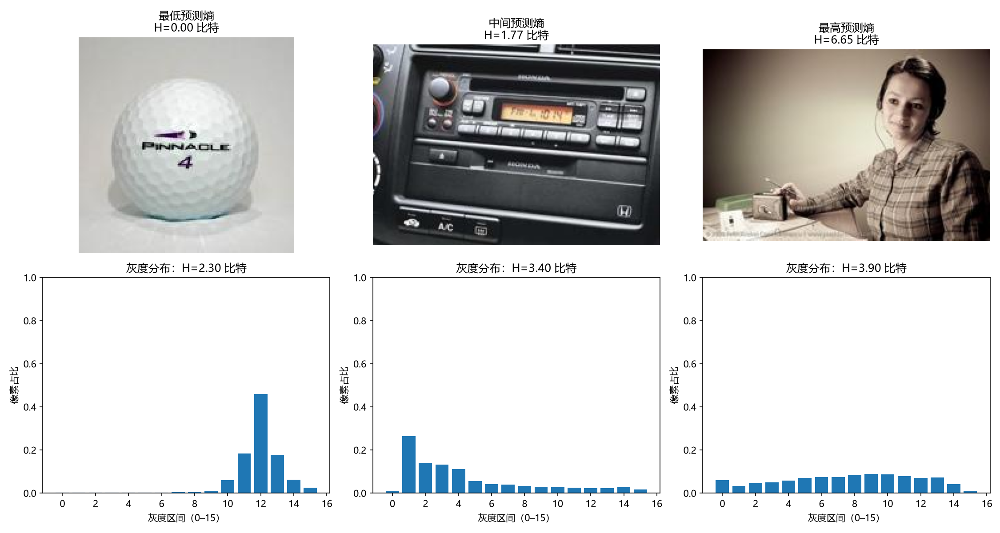
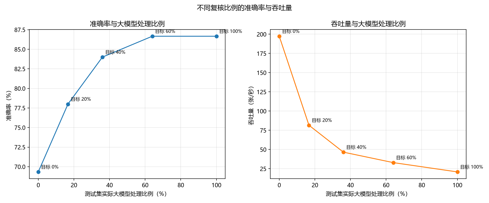

# 信息熵与交叉熵在图像分类推理中的应用

姓名：________　学号：________　日期：________

## 一、实验目标

本实验选择信息论作业的挑战一和挑战二，研究概率分布、信息熵、交叉熵及预测置信度的关系。随后将置信度用于图像分类推理分流，观察准确率与计算速度之间的权衡。

## 二、实验环境与方法

实验在 Windows 上使用 Python、PyTorch 和 TorchVision 完成，模型在 CPU 上运行。使用 Imagenette 的验证集，固定随机种子 42 抽取 300 张图像。涉及温度缩放和固定阈值的实验，再用随机种子 123 把它们划分为各 150 张的调参集和测试集。两种分类模型分别使用 MobileNetV3-Small 和 ResNet50 的 ImageNet 预训练权重，输入分别使用对应权重的预处理。

数据集使用 10 个类别，预训练模型输出 1000 个类别。实验将数据集标签映射到 ImageNet 对应类别，概率和交叉熵仍按全部 1000 个输出类别计算。

## 三、挑战一：概率分布与信息熵

信息熵用来衡量随机变量的不确定性。对概率分布 p，按底数 2 计算：

$$H(X) = -\sum_{p_i > 0} p_i \log_2 p_i \quad (\text{bit})$$

将一张模拟灰度图设为 8 个像素，随机抽取一个像素，研究它的灰度值分布。

| 像素数据 | 灰度 0、1、2、3 的概率 | 熵（bit） |
| --- | --- | ---: |
| `[0,0,0,0,0,0,0,0]` | 1、0、0、0 | 0 |
| `[0,0,1,1,0,1,0,0]` | 0.625、0.375、0、0 | 约 0.9544 |
| `[0,0,1,2,2,1,3,3]` | 0.25、0.25、0.25、0.25 | 2 |

第一组的灰度值确定，熵最小。第三组四种灰度等可能，达到四种取值时的最大熵 2 bit。打乱像素顺序不会改变频率和该熵值，因为这个统计不包含像素位置。

进一步对真实图片计算灰度分布：将灰度分为 16 个区间，计算每个区间的像素比例及其熵。下图展示了按模型预测熵挑选的三张图片及其灰度分布。这是不同图片之间的对比，并非同一张图片随时间发生熵增。预测熵来自模型的类别概率，灰度熵来自像素分布，两者的随机变量不同。



## 四、挑战二：准确率、置信度与交叉熵

分类准确率只看预测类别是否正确。单张图片的交叉熵为真实类别概率的负自然对数，整个测试集取均值：

$$L = -\frac{1}{N}\sum_{i=1}^{N}\ln p(y_i\mid x_i)$$

模型给真实类别的概率越低，这张图的交叉熵越大。PyTorch 的 `cross_entropy` 接收模型原始分数 logits，并结合真实类别计算平均损失。

### 4.1 温度缩放实验

使用同一个 MobileNet 输出构造两套预测：原始 logits，以及 logits 除以正数温度 T 后得到的输出。正温度不改变类别排名，因此两套预测的准确率相同。调参集在 0.50 至 3.00 之间以 0.01 为步长搜索温度，选择调参集交叉熵最小的值，再固定该值评估测试集。

| 指标 | 调整前 | 调整后 |
| --- | ---: | ---: |
| 调参集选出的温度 | 1.00 | 1.13 |
| 测试集准确率 | 69.33% | 69.33% |
| 测试集平均交叉熵 | 1.1276 | 1.1800 |
| 测试集预测类别变化数 | — | 0 |

调参集上的最低交叉熵为 1.6786。测试集上，逐图统计有 22 张交叉熵降低、127 张升高、1 张基本不变。本次调整没有降低测试集的平均交叉熵。调参集和测试集各 150 张，其样本差异可能影响选出的温度和测试结果。

以编号 2232 的图片为例，真实类别是 French horn，模型预测 plate rack。调整后真实类别概率由 0.0003 上升到 0.0006，交叉熵从 7.9868 降到 7.4531，但预测仍然错误。编号 1384 的图片预测正确，真实类别概率从 0.2362 降至 0.1650，交叉熵从 1.4430 升到 1.8018，预测仍然正确。这说明预测类别相同时，交叉熵仍能反映真实类别概率的变化。

### 4.2 置信度分组

置信度取预测概率最高的类别的概率。按调整前的置信度分为五组，结果如下：

| 置信度区间 | 图片数 | 平均置信度 | 实际准确率 | 平均交叉熵 |
| --- | ---: | ---: | ---: | ---: |
| 0.0–0.2 | 14 | 15.33% | 21.43% | 3.5179 |
| 0.2–0.4 | 19 | 30.81% | 36.84% | 2.0120 |
| 0.4–0.6 | 37 | 50.99% | 51.35% | 1.5584 |
| 0.6–0.8 | 23 | 70.24% | 78.26% | 0.9153 |
| 0.8–1.0 | 57 | 95.14% | 100.00% | 0.0519 |

本次测试中，高置信度组的准确率整体较高，支持用置信度为复核安排优先级。各组样本量有限，组内频率不能视为模型在所有数据上的真实准确率。温度调整后图片可能进入不同分组，因此调整前后同一区间不是逐张配对比较。

## 五、工程实验：置信度分流

先用 MobileNet 预测，将低置信度图片交给 ResNet50 重新预测，其余图片保留 MobileNet 的结果。目标复核比例为 20%、40%、60% 时，分别在调参集根据原始置信度选定阈值，再应用到测试集。实际复核数量由固定阈值决定。

CPU 使用 8 线程、批大小为 16。每种方案预热一次，测量 3 次并取中位数。计时包含预处理和推理，图片解码和模型加载在计时前完成。0% 为全量 MobileNet，100% 为全量 ResNet50，两个端点分别只运行对应模型。

| 调参集目标复核比例 | 测试集实际大模型处理 | Top-1 | 中位耗时 | 吞吐量 |
| --- | ---: | ---: | ---: | ---: |
| 0% | 0/150 | 69.33% | 0.760 秒 | 197.38 张/秒 |
| 20% | 25/150 | 78.00% | 1.838 秒 | 81.59 张/秒 |
| 40% | 54/150 | 84.00% | 3.220 秒 | 46.58 张/秒 |
| 60% | 96/150 | 86.67% | 4.549 秒 | 32.97 张/秒 |
| 100% | 150/150 | 86.67% | 7.190 秒 | 20.86 张/秒 |



在这批测试图片上，目标 60% 的方案复核了 96 张，准确率与全量 ResNet50 同为 86.67%。其吞吐量约为全量 ResNet50 的 1.58 倍，中位耗时减少约 36.7%。准确率相同并不能说明两个方案对每张图的预测都相同。目标 40% 的方案耗时更低，准确率则低于全量 ResNet50 2.67 个百分点。

本次结果用于探索速度与准确率的取舍。目标 60% 的三次耗时分别为 3.614、4.549、5.304 秒，存在波动。测试集此前已经用于观察分流效果，若要独立验证最终选定方案，应使用未参与方案选择的新图片。

## 六、结论

信息熵描述所定义的随机变量的不确定性，分布越均匀并不等同于图片运动越剧烈。交叉熵能区分预测类别一致但概率不同的结果；本次调参集选出的温度并未降低测试集交叉熵。工程实验表明，在这批图片和该计时范围下，按置信度分流能够在准确率与吞吐量之间提供不同选择。

## 附录：运行代码

本仓库包含四个完整脚本。Windows PowerShell 中创建虚拟环境并安装依赖后，依次运行：

```powershell
python -m venv .venv
.\.venv\Scripts\python.exe -m pip install torch torchvision --index-url https://download.pytorch.org/whl/cpu
.\.venv\Scripts\python.exe -m pip install matplotlib
.\.venv\Scripts\python.exe .\problem_1.py
.\.venv\Scripts\python.exe .\predict_entropy.py
.\.venv\Scripts\python.exe .\verify_routing.py
.\.venv\Scripts\python.exe .\benchmark_routing.py
```

首次运行 `predict_entropy.py` 需要下载 Imagenette 160px 数据集和 MobileNet 权重，`verify_routing.py` 首次运行还需下载 ResNet50 权重。数据、虚拟环境与模型权重未上传到本仓库。请在仓库根目录运行上述命令，以便脚本找到 `data` 目录。CPU 性能、软件版本和系统负载会影响运行时间。
